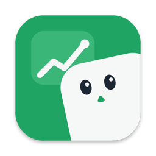

<p align="center"></p>

# StockFloat Native

[StockFloat](https://github.com/lesenelir/stock-float) written in Go alone with [MyGo](https://mygo.egoist.dev/docs)'s [native UI](https://mygo.egoist.dev/docs/ui): no web page, no JavaScript and no webview. MyGo draws the panel and the settings window itself, on the GPU. It is the sibling of [stock-float-mygo](https://github.com/lesenelir/stock-float-mygo), which shows the same app in web pages. [How the two differ, and a reading guide to the code](docs/native-ui.zh-CN.md) (中文).

A small always-on-top panel for macOS that shows live prices and daily change for the stocks you follow. It floats in the top-right corner, stays visible on every desktop and over full-screen apps, and never takes focus.

- US stocks, Hong Kong stocks and A-shares
- A second line per stock for pre-market, post-market and overnight prices (with Longbridge)
- Chinese and English interface
- Everything is in the panel's right-click menu and the menu bar icon

It reads and writes the same settings as the other versions, `~/.config/stock-float/config.json`, so it picks up your watch list.

## Use

Right-click the panel, or click the line-chart icon in the menu bar, for the menu:

- **Settings…** edits the watch list and data sources.
- **Price Alerts…** sets an alert on a symbol of the watch list: when its price rises or falls to the target, a macOS notification says so, once, and the alert goes away. Pre-market, post-market and overnight prices count too.
- **Hide Panel** / **Show Panel**. Press **⌃⌥S** in any app to do the same; clicking the Dock icon or opening the app again also brings a hidden panel back.
- **Appearance** sets the colors (green up, red up, or no color), the text size and the opacity.
- **Language** switches between System, 中文 and English.
- **Click-through** lets clicks pass through the panel; hold ⌥ to interact with it again.
- **Show in Dock** turns the Dock icon off or on; the menu bar icon stays either way.
- **Launch at login**

Drag the panel to move it; the position is remembered. A row fades when its price has not updated for 30 minutes.

### Symbols

| Market | Format | Example |
| --- | --- | --- |
| US | the ticker | `AAPL` |
| Hong Kong | `hk` + 5 digits | `hk00700` |
| Shanghai | `sh` + 6 digits | `sh600519` |
| Shenzhen | `sz` + 6 digits | `sz000001` |

To change the shortcut, edit `hotkey` in the settings file (for example `"cmd+shift+9"`, or `""` for none) and restart the app.

## Data sources

| Source | Markets | Setup | Freshness |
| --- | --- | --- | --- |
| Tencent (default) | US, Hong Kong, A-shares | none | US prices are snapshots about every 20 seconds |
| Longbridge | US | a Longbridge account and its CLI | pushed trade by trade, plus pre-market, post-market and overnight |
| Finnhub | US | a free API key | pushed trade by trade, regular session |

For Longbridge, install its CLI and log in, then turn on **Use Longbridge for US quotes** in Settings:

```sh
brew install --cask longbridge/tap/longbridge-terminal
longbridge auth login
```

## Develop

Requires [Go](https://go.dev/dl/) 1.27 or later, and nothing else: `go.mod` pins the MyGo CLI as a tool.

```sh
go tool mygo dev     # the development app, rebuilt as you edit
go test ./...        # including the views, which run without a window
go tool mygo build   # build/darwin-arm64/StockFloat Native.app and a disk image
go tool mygo build -platform darwin/universal
```

`swift scripts/make-icons.swift` redraws the app icon, the menu bar icon and the session marks from `assets/icon-source.png` and SF Symbols.

Pushing a tag `v<version>` (the `version` in mygo.json) builds the universal app and attaches it to a draft release.

## Disclaimer

Prices come from third-party sources and may be delayed or wrong. Nothing here is investment advice.

## License

[MIT](LICENSE)
